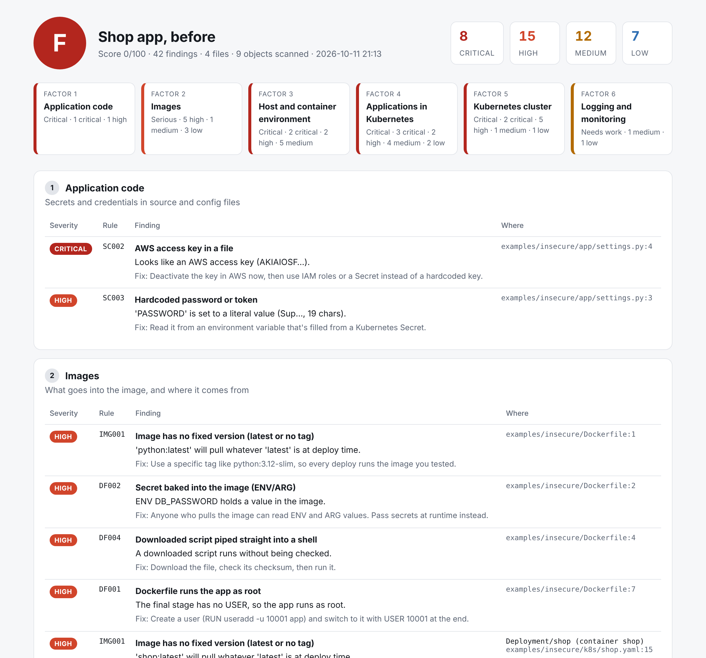
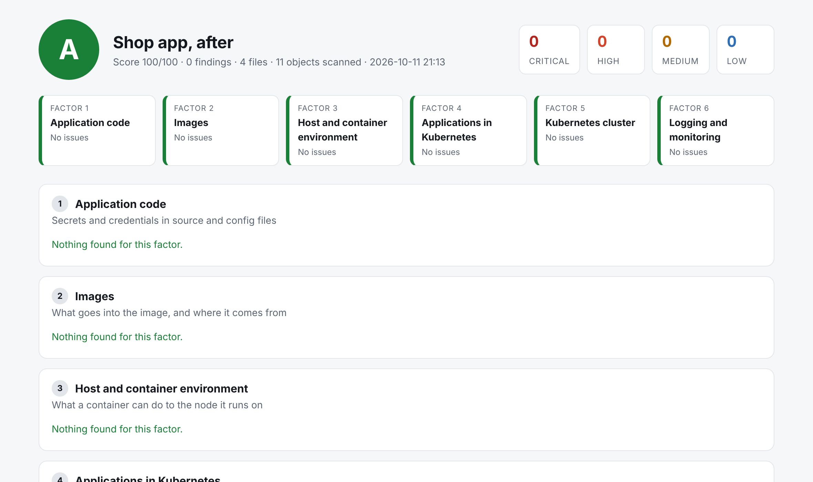

# Shipshape

**A security checker for Dockerfiles and Kubernetes files.** Point it at a
project, or pipe in a live cluster, and it tells you what's risky, why, and
how to fix it. Findings are grouped by the **five-factor container security
model**: code, images, host and container environment, applications in
Kubernetes, and the cluster itself.




I built this to put into practice what I learned in **Securing Containers and
Kubernetes Ecosystem** (LinkedIn Learning, Sam Sehgal). Each of the course's
five factors is a group of rules, and the table below maps the course
chapters to the rules.

## Try it

```bash
pip install -e .
shipshape scan examples/insecure      # the "before" app: grade F, 42 findings
shipshape scan examples/hardened      # the same app fixed: grade A, 0 findings
shipshape scan examples/insecure --format html -o report.html   # the report above
shipshape rules                       # list all 47 rules
```

Scan your own project, or your **live minikube cluster**:

```bash
shipshape scan path/to/project
kubectl get pods -n kube-system -o yaml | shipshape scan -       # control plane + system pods
kubectl get deploy,sts,ds,cronjob,svc,ns,netpol,roles,rolebindings -A -o yaml | shipshape scan -
```

In a CI pipeline, use it as a gate: `shipshape scan . --fail-on high` exits
with code 1 if anything high or critical is found. `--format sarif` gives
GitHub code scanning a file it can show on pull requests.

## Course chapters → rules

| Course | What Shipshape checks | Rules |
|---|---|---|
| **Factor 1: Securing application code** (secure design, secure code) | Private keys, AWS keys, and passwords or tokens written into source and config files | SC001–SC003 |
| **Factor 2: Securing images** | `latest` or untagged images, no digest pin, untrusted registries (`--trusted-registry`), Dockerfiles that run as root, secrets in `ENV`/`ARG`, `ADD` from a URL, `curl \| sh`, no `HEALTHCHECK` | IMG001–003, DF001–005 |
| **Factor 3: Securing hosts and the container working environment** (network, ports, host OS protection) | Privileged containers, `hostNetwork`/`hostPID`/`hostIPC`, `hostPath` mounts, `hostPort`, privilege escalation, dangerous capabilities, not dropping `ALL`, writable root filesystem, no seccomp profile, no CPU or memory limits | K8S001–010 |
| **Factor 4: Securing applications in Kubernetes** (Pod Security Standards, authentication, authorization, admission control, security context, network security, secrets) | Running as root, service-account tokens mounted by default, the `default` service account, secrets as plain env values, Secrets committed to Git, namespaces without a Pod Security `enforce` label, namespaces with no NetworkPolicy, public Services, RBAC wildcards, roles that can read Secrets or escalate (`pods/exec`, `bind`, `escalate`, `impersonate`), `cluster-admin` bindings, bindings to anonymous users | K8S011–018, RBAC001–006 |
| **Factor 5: Securing the Kubernetes cluster** (API server traffic, cluster components) | API server: anonymous auth, `AlwaysAllow` authorization, insecure port, no `NodeRestriction`, no TLS, no encryption at rest. etcd: no client-cert auth, no TLS. Controller manager and scheduler listening on all interfaces, profiling on | CL001–006, CL008–011 |
| **Additional: logging and monitoring** | API server audit logging off, containers with no health probes | CL007, MON001 |

## Before and after

`examples/insecure` and `examples/hardened` are the **same small shop app**,
written two ways. Every finding in the first one is fixed in the second, so
reading the two side by side is a quick tour of the course:

| | Before | After |
|---|---|---|
| Settings | Password and AWS key in `settings.py` | Read from env vars, filled from a Secret |
| Dockerfile | `python:latest`, password in `ENV`, `curl \| sh`, runs as root | Tag plus digest, non-root `USER 10001`, `HEALTHCHECK` |
| Pod | `privileged`, `hostNetwork`, mounts `docker.sock`, `SYS_ADMIN` | Non-root, read-only filesystem, drops `ALL`, seccomp, limits, probes |
| Access | Wildcard ClusterRole, `cluster-admin` for the default service account and unauthenticated users | Its own service account, no token, a Role that reads one ConfigMap |
| Network | `NodePort` and `hostPort`, no NetworkPolicy | `ClusterIP`, default-deny plus one allow rule |
| Namespace | No Pod Security label | `enforce: restricted` |
| Control plane | `AlwaysAllow`, insecure port, etcd over plain HTTP | RBAC, `NodeRestriction`, TLS everywhere, encryption at rest, audit log |



## Run on my own projects

I scanned two of my own Kubernetes projects:

- **[Crane](https://github.com/ShrinidhiMane/crane)** got **A (90/100)**. It
  has only low-level notes, like images pinned by tag and not by digest, and
  pods using the default service account.
- **[ReliefLink](https://github.com/ShrinidhiMane/relieflink)** got **D**.
  Shipshape caught that its **PostgreSQL pod runs as root**, with privilege
  escalation allowed and a writable filesystem. I had hardened the app pods
  but missed the database. That's exactly the kind of gap a tool like this
  exists to catch.

A live minikube scan of `kube-system` gives realistic results too. It flags
`kube-proxy` as privileged with `hostNetwork` (it needs both to program the
node's network rules). It also shows the defaults kubeadm ships with: anonymous
auth on, no encryption at rest, and no audit log.

## Accepting a finding on purpose

Sometimes a finding is expected. You can suppress it, but you have to say why,
in the file, where a reviewer will see it:

```yaml
metadata:
  annotations:
    shipshape.dev/ignore: "K8S012: the operator lists pods through the API"
```

```dockerfile
# shipshape:ignore DF005 health checks are Kubernetes probes in this project
```

Suppressed findings still show up in the report, in their own section, with
the reason.

## How it works

- `shipshape/loader.py` finds Kubernetes YAML (including multi-document files
  and `kubectl ... -o yaml` lists), Dockerfiles, and source files.
- `shipshape/rules/` has one module per factor: `code.py`, `images.py`,
  `host.py`, `apps.py`, `cluster.py` and `monitoring.py`.
- Control-plane pods (kube-apiserver, etcd, controller manager, scheduler)
  are checked against cluster rules, not workload rules. They use
  `hostNetwork` by design, so flagging that would just be noise.
- Score = 100 minus points (critical 20, high 8, medium 3, low 1). Any
  critical finding caps the grade at F.

## Tests

```bash
pip install -e ".[dev]"
pytest -q        # 55 tests
```

Each rule has a test that triggers it and a test that shows the safe version
passes, plus tests for known false positives (`os.environ[...]`, `${VAR}`
placeholders, `change-me`, build `ARG`s, multi-stage builds). There's also an
end-to-end test that pipes in a minikube `kubectl get pods -o yaml` dump. CI
runs the tests on Python 3.10 and 3.12, then uses Shipshape as a gate: the
hardened example must pass with zero findings, and the insecure one must be
blocked.

## Limits

Shipshape reads files. It doesn't scan image layers for CVEs (use Trivy or
Grype for that), and it doesn't check the node OS or kubelet config files (use
kube-bench). It's meant to catch misconfigurations early, before they're
deployed.
